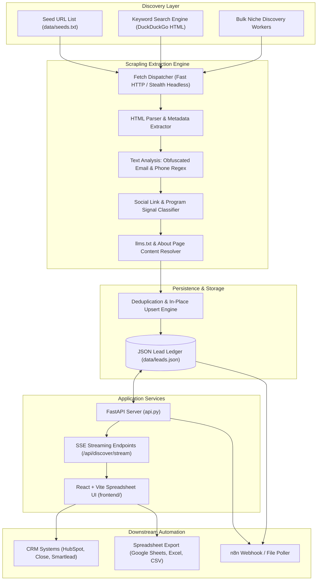
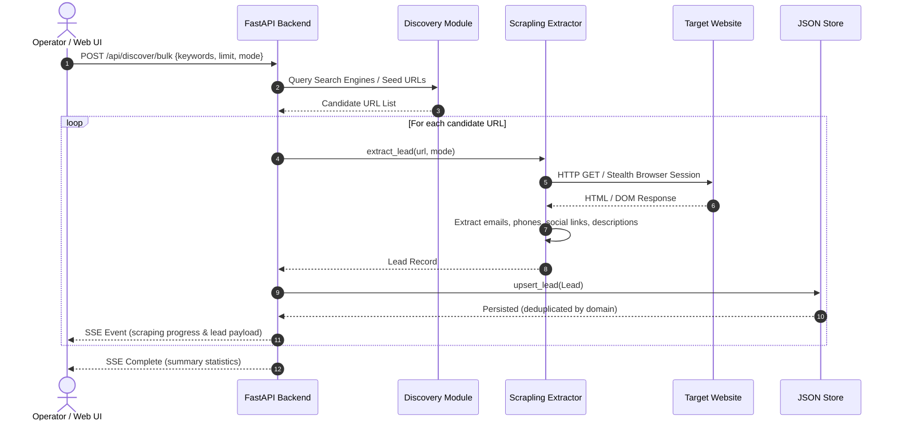
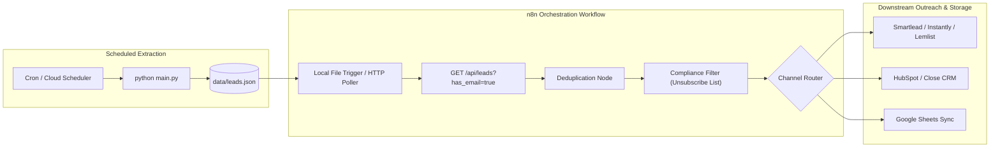

# Lead Ledger: Business & Affiliate Outreach Intelligence

Lead Ledger is an automated lead discovery, extraction, and management platform designed to identify, verify, and organize contact details from niche content publishers, business sites, and affiliate platforms.

The engine leverages Scrapling for resilient HTTP and stealth browser fetching, parses unstructured content into validated data schemas, provides a streaming FastAPI backend, and presents an interactive web sheet for seamless export to CRM platforms, n8n workflows, and spreadsheet tools.

---

## Architecture Overview



---

## Core Capabilities

- Multi-Mode Scraping: Supports Fast mode (high-throughput plain HTTP) and Stealthy mode (browser-level fingerprint spoofing to handle JavaScript rendering and anti-bot challenges).
- Robust Lead Extraction: Parses direct and obfuscated emails (e.g. `user [at] domain [dot] com`), phone numbers, social profiles (LinkedIn, X/Twitter, Instagram, YouTube, Facebook, Pinterest), business descriptions, and affiliate disclosures.
- Contextual Resolution: Intelligently resolves publisher descriptions via `llms.txt`, Open Graph metadata, and `/about` page traversal.
- Real-Time Streaming: Provides Server-Sent Events (SSE) for continuous progress tracking during single-niche and multi-worker bulk discoveries.
- Interactive Web Sheet: Vite/React interface featuring real-time keyword filtering, one-click TSV clipboard copying for Google Sheets and Excel, and CSV export.
- n8n and Cold Outreach Integration: Ready-to-use API endpoints for scheduled pipeline runs, webhook ingestion, and CRM updates.

---

## Lead Extraction Pipeline



---

## Repository Structure

```
scrapbusinessinfo/
├── README.md                      # System documentation and operational reference
├── .gitignore                     # Repository-level exclusions (credentials, data, caches)
└── app/
    ├── config.py                  # Environment-driven application settings
    ├── main.py                    # Command-line interface for scraping and discovery
    ├── api.py                     # FastAPI REST and SSE streaming server
    ├── requirements.txt           # Python package dependencies
    ├── pytest.ini                 # Test suite configuration
    ├── test_all_services.py       # End-to-end integration and smoke verification test
    ├── .env.example               # Template environment configuration file
    ├── data/
    │   ├── seeds.txt              # Primary seed URLs for scraping
    │   └── leads.json             # Local database (auto-generated, git-ignored)
    ├── scraper/
    │   ├── __init__.py
    │   ├── models.py              # Pydantic data schemas (Lead, SocialLinks)
    │   ├── extractor.py           # Page fetching, DOM traversal, and data extraction
    │   ├── discovery.py           # Seed ingestion and search engine discovery
    │   ├── utils.py               # Parsing utilities (regex, signals, domain normalization)
    │   └── store.py               # JSON storage read, write, and upsert routines
    ├── tests/
    │   ├── test_api.py            # API endpoint and SSE response tests
    │   ├── test_cli.py            # CLI argument and seed parsing tests
    │   ├── test_discovery.py      # Publisher filtering and deduplication tests
    │   ├── test_extractor.py      # HTML and llms.txt extraction tests
    │   ├── test_models.py         # Data validation tests
    │   ├── test_store.py          # Data store persistence tests
    │   └── test_utils.py          # Helper function tests
    └── frontend/
        ├── index.html             # Single-page application entry point
        ├── package.json           # Frontend dependency manifest
        ├── vite.config.js         # Vite bundler configuration
        └── src/
            ├── main.jsx           # React DOM root
            ├── App.jsx            # Main view, discovery controls, and metrics
            ├── index.css          # Tailwind CSS styling definitions
            └── components/
                └── Sheet.jsx      # Sortable, filterable lead table with export
```

---

## Getting Started

### Prerequisites

- Python 3.10 or higher
- Node.js 18 or higher with npm
- Modern browser (Chrome / Chromium) for stealth scraping mode

### Backend Setup

1. Navigate to the application directory:
   ```bash
   cd app
   ```

2. Create and activate a Python virtual environment:
   ```bash
   python3 -m venv venv
   source venv/bin/activate
   # On Windows: venv\Scripts\activate
   ```

3. Install required dependencies:
   ```bash
   pip install -r requirements.txt
   ```

4. Install browser engines for Scrapling:
   ```bash
   scrapling install
   ```

5. Configure environment variables:
   ```bash
   cp .env.example .env
   ```

### Frontend Setup

1. Open a new terminal session and navigate to the frontend directory:
   ```bash
   cd app/frontend
   ```

2. Install JavaScript packages:
   ```bash
   npm install
   ```

3. Launch the development server:
   ```bash
   npm run dev
   ```

The web dashboard is accessible at `http://localhost:5173`.

---

## Configuration Reference

Settings are managed via `app/.env` and loaded by `app/config.py`:

| Parameter | Type | Default | Description |
| :--- | :--- | :--- | :--- |
| `DEFAULT_FETCH_MODE` | String | `fast` | Extraction strategy: `fast` (plain HTTP) or `stealthy` (headless browser). |
| `REQUEST_DELAY` | Float | `2.0` | Politeness delay in seconds between consecutive requests to the same host. |
| `LEADS_FILE` | String | `data/leads.json` | Path to the local JSON file where verified leads are persisted. |
| `SEEDS_FILE` | String | `data/seeds.txt` | Path to text file holding target seed domains. |
| `SEARCH_RESULTS_PER_KEYWORD` | Integer | `15` | Default number of candidate search results queried per keyword. |

---

## Usage Guide

### 1. Command-Line Interface

Run the scraper directly from the terminal using `app/main.py`:

- Scrape all URLs listed in `app/data/seeds.txt`:
  ```bash
  python main.py
  ```

- Scrape a single target URL:
  ```bash
  python main.py --url "https://example-publisher.com/reviews"
  ```

- Discover and scrape candidates by niche keyword:
  ```bash
  python main.py --keyword "specialty coffee gear" --limit 20
  ```

- Execute using stealth browser mode:
  ```bash
  python main.py --keyword "ergonomic office chairs" --mode stealthy
  ```

- Filter output strictly to sites with discovered email addresses:
  ```bash
  python main.py --keyword "camping gear" --has-email-only
  ```

### 2. FastAPI Backend Service

Start the live REST API:

```bash
uvicorn api:app --reload --port 8000
```

Interactive OpenAPI documentation is hosted at `http://localhost:8000/docs`.

#### Primary API Endpoints

| Method | Endpoint | Description |
| :--- | :--- | :--- |
| `GET` | `/api/health` | System health check and storage path verification. |
| `GET` | `/api/leads` | Retrieve stored leads. Filter by `?has_email=true`, `?niche=value`, or `?search=query`. |
| `GET` | `/api/stats` | Aggregate metrics (total leads, email availability rate, top niches). |
| `POST` | `/api/discover` | Synchronous discovery and scraping for a given keyword. |
| `POST` | `/api/discover/stream` | Server-Sent Events stream providing real-time scraping progress for a keyword. |
| `POST` | `/api/discover/bulk` | Parallel multi-worker discovery across an array of keywords. |
| `POST` | `/api/discover/bulk/stream` | Server-Sent Events stream for multi-threaded bulk discovery jobs. |
| `DELETE` | `/api/leads` | Prune leads by niche or clear the entire dataset (`?niche=ALL`). |

---

## Integration with Automation Platforms (n8n, Make, CRMs)



### Automation Patterns

1. Direct File Polling: Configure n8n with a Local File Trigger monitoring `data/leads.json`. When modified, map newly appended records directly to outreach sequences.
2. HTTP Endpoint Polling: Query `GET http://localhost:8000/api/leads?has_email=true` at scheduled intervals (e.g. daily at 08:00 UTC).
3. Webhook Dispatch: Trigger custom downstream workflows using FastAPI endpoint webhooks to ingest records into your CRM.

---

## Verification & Testing

Execute the comprehensive test suite covering unit tests, CLI execution, live FastAPI endpoints, and frontend production bundling:

```bash
cd app
python test_all_services.py
```

To run unit tests exclusively:

```bash
cd app
pytest tests -v
```

---

## Legal & Compliance Guidelines

- Publicly Available Information: Only collect contact details and metadata published openly by website owners. Do not attempt to bypass login gates, authentication challenges, or paywalls.
- Respect Host Policies: Adhere to target domain `robots.txt` directives and maintain reasonable politeness delays (`REQUEST_DELAY >= 2.0s`) to avoid server degradation.
- CAN-SPAM Compliance (United States): Commercial outreach emails must include a clear opt-out mechanism, a valid physical postal address, and non-deceptive subject lines.
- GDPR and PECR Compliance (EU & UK): Direct email marketing to corporate contacts requires legitimate interest assessments and immediate opt-out compliance. Direct outreach to individual sole traders requires prior consent in certain jurisdictions.
- Suppression Management: Always maintain a centralized suppression list across campaigns to permanently honor opt-out and unsubscribe requests.
